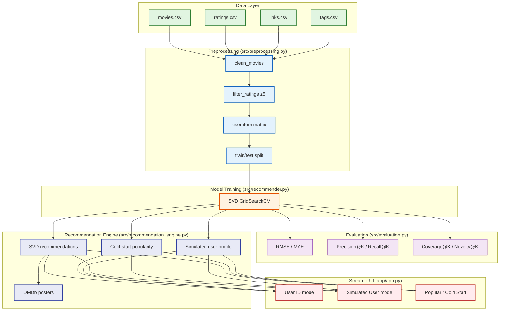

# Movie Recommender System

Collaborative filtering movie recommendation system built with Python, pandas, scikit-learn, scikit-surprise, and Streamlit. Uses MovieLens ml-latest-small dataset.

## Project Overview

| Aspect | Details |
|--------|---------|
| **Approach** | Collaborative Filtering (SVD ) |
| **Dataset** | MovieLens ml-latest-small (9,742 movies, 100,836 ratings, 610 users) |
| **Stack** | Python, pandas, scikit-learn, scikit-surprise, Streamlit, OMDb API |
| **Deployment** | Streamlit Community Cloud |

## Demo


## Architecture



Pipeline stages (each with a matching notebook in `notebooks/`):

1. `src/data_loader.py` — reads the four MovieLens CSVs from `data/raw/*.csv`; parquet helpers for `data/processed/`.
2. `src/preprocessing.py` — clean movies, filter ≥5 ratings per user/movie, build sparse user-item matrix + mappings, train/test split, save artifacts.
3. `src/recommender.py` — SVD `GridSearchCV` training, persists best estimator to `data/processed/models/`.
4. `src/evaluation.py` — RMSE/MAE plus Precision@K, Recall@K, Coverage@K, Novelty@K, and popularity baseline.
5. `src/recommendation_engine.py` — metadata enrichment, OMDb posters, cold-start and simulated-user helpers.
6. `app/app.py` + `app/utils.py` — Streamlit UI (3 modes: User ID / Simulated User / Popular).

## Project Structure

```
movie-recommender/
├── data/
│   ├── raw/              # Original MovieLens CSV files
│   └── processed/        # Cleaned data, pickled models (gitignored)
├── notebooks/
│   ├── 01_eda.ipynb      # Exploratory Data Analysis
│   ├── 02_preprocessing.ipynb  # User-item matrix, train/test split
│   ├── 03_model_training.ipynb # SVD, k-NN training & tuning
│   └── 04_evaluation.ipynb     # RMSE, Precision@K, Coverage
├── scripts/
│   ├── evaluate_models.py
│   ├── test_recommendation_engine.py
│   ├── test_streamlit_imports.py
│   └── check_genres.py
├── src/
│   ├── __init__.py
│   ├── data_loader.py    # Load raw/processed data
│   ├── preprocessing.py  # Data cleaning, user-item matrix
│   ├── recommender.py    # CF model training, prediction, recommendations
│   ├── evaluation.py     # RMSE, Precision@K, Coverage metrics
│   └── recommendation_engine.py  # Metadata enrichment, posters, cold start
├── app/
│   ├── __init__.py
│   ├── app.py            # Streamlit UI (3 modes: User ID, Simulated User, Popular)
│   └── utils.py          # Poster fetching, formatting, caching
├── tests/
│   ├── test_data_loader.py
│   ├── test_preprocessing.py
│   ├── test_recommender.py
│   ├── test_evaluation.py
│   └── test_recommendation_engine.py
├── .streamlit/
│   ├── config.toml       # Streamlit configuration
│   └── secrets.toml      # API keys (gitignored)
├── requirements.txt
├── packages.txt          # System deps for Streamlit Cloud
├── .gitignore
└── README.md
```

## Progress Tracker

### Day 1 - Setup & Data Loading ✅
- [x] Initialize git repository
- [x] Create project folder structure
- [x] Download MovieLens ml-latest-small dataset
- [x] Create `requirements.txt` with core + dev dependencies
- [x] Create `.gitignore` (ignores processed data, cache, secrets)
- [x] Build `src/data_loader.py` for loading raw/processed data
- [x] Create EDA notebook boilerplate (`notebooks/01_eda.ipynb`)
- [x] Create virtual environment & install all dependencies (including scikit-surprise)
- [x] Verify data loading works (9,742 movies, 100,836 ratings, 610 users)

### Day 2 - Data Cleaning & EDA ✅
- [x] Run EDA notebook to generate insights (7 visualizations saved)
- [x] Build `src/preprocessing.py` with cleaning logic
- [x] Filter movies with ≥5 ratings, users with ≥5 ratings
- [x] Handle missing values, parse genres, extract years
- [x] Build user-item sparse matrix (610 × 3,650, 95.9% sparsity)
- [x] Train/test split by user (hold out last 20% per user)
- [x] Save cleaned data to `data/processed/` (parquet + joblib)
- [x] Create `notebooks/02_preprocessing.ipynb` documenting pipeline
- [x] Add `tests/test_preprocessing.py` (7 tests, all passing)

### Day 3 - Model Training (CF) ✅
- [x] Train SVD (matrix factorization) with grid search (n_factors=150, n_epochs=30, lr=0.01, reg=0.1)
- [x] Train k-NN (item-based) as baseline (k=60, min_k=3, sim=MSD)
- [x] Hyperparameter tuning via GridSearchCV (3-fold CV)
- [x] Save best models (`algo_svd.pkl`, `algo_knn.pkl`)
- [x] Create `notebooks/03_model_training.ipynb` documenting training
- [x] Add `tests/test_recommender.py` (10 tests, all passing)

### Day 4 - Evaluation ✅
- [x] RMSE, MAE on test set: SVD (0.846, 0.647) vs k-NN (0.897, 0.688)
- [x] Precision@10, Recall@10 vs. popularity baseline: SVD (0.528, 0.686) vs Pop (0.066)
- [x] Coverage & novelty metrics: SVD (0.620, 0.940) vs k-NN (0.672, 0.941)
- [x] Compare SVD vs. k-NN: SVD wins on accuracy, k-NN wins on coverage
- [x] Create `src/evaluation.py` with comprehensive metrics
- [x] Add `tests/test_evaluation.py` (7 tests, all passing)

### Day 5 - Recommendation Engine ✅
- [x] `get_user_recommendations_with_metadata(user_id, model, top_n=10)` with full movie metadata
- [x] Cold-start fallback: popularity-based for new/unknown users
- [x] Map inner IDs back to movie titles, genres, years, IMDB/TMDB IDs
- [x] OMDb API integration for poster fetching (with LRU caching)
- [x] User rating history retrieval for "simulated user" mode
- [x] Create `src/recommendation_engine.py` with unified interface (SVD/k-NN/Popularity)
- [x] Add `tests/test_recommendation_engine.py` (9 tests, all passing)
- [x] All 37 tests passing across all modules

### Day 6 - Streamlit UI ✅
- [x] User ID input (1-610) → recommendations grid with posters
- [x] Three modes: User ID, Simulated User, Popular (Cold Start)
- [x] Model selector: SVD / k-NN / Popularity Baseline
- [x] OMDb API integration for movie posters (with caching)
- [x] Loading states, error handling, success messages
- [x] Responsive movie grid layout (4 columns)
- [x] User rating history display
- [x] Model metrics display (RMSE, MAE, Precision@10, Recall@10, Coverage@10)
- [x] Created `app/app.py` (main UI) and `app/utils.py` (helpers)
- [x] Streamlit config: `.streamlit/config.toml`, `.streamlit/secrets.toml`, `packages.txt`

### Day 7 - Polish UI ✅
- [x] Styling refinements, responsive layout
- [x] "Simulated user" mode: select rated movies → get recs
- [x] Default mode set to Simulated User
- [x] Sidebar collapsed by default; model metrics unchecked by default
- [x] Model comparison toggle (SVD vs k-NN side-by-side)
- [x] Performance metrics display

### Day 8 - Documentation & Deploy
- [x] Update README with CF architecture diagram
- [ ] Record demo GIF 

## Quick Start

```bash
# Clone & setup
git clone <repo-url>
cd movie-recommender
python -m venv .venv
.venv\Scripts\Activate.ps1  # Windows
pip install -r requirements.txt

# Run EDA
jupyter notebook notebooks/01_eda.ipynb

# Run Streamlit app (after Day 7)
streamlit run app/app.py
```

## Default UI Behavior

- **Recommendation mode**: Simulated User (pick movies → get recommendations)
- **Sidebar**: collapsed by default
- **Show Model Metrics**: unchecked by default
- **Get Recommendations** button now appears directly below the movie search bar in Simulated User mode

## Dataset

- **Source**: [GroupLens MovieLens](https://grouplens.org/datasets/movielens/latest/)
- **Version**: ml-latest-small
- **Files**: movies.csv, ratings.csv, links.csv, tags.csv

## Evaluation Metrics

| Metric | Target |
|--------|--------|
| RMSE | < 0.90 |
| MAE | < 0.70 |
| Precision@10 | > 0.15 |
| Coverage | > 0.30 |

## Future Improvements

- Hybrid recommender (CF + content-based)
- Implicit feedback (ALS via `implicit` library)
- Deep learning: Neural CF, AutoEncoders
- Real-time model retraining pipeline
- A/B testing framework
- Docker containerization

## License

MIT License - see LICENSE file for details.
